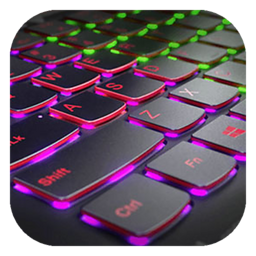

<div align="center">
  

  # Lenovo Y720 Keyboard Backlight

  *Set the colors of your Lenovo Legion Y720 keyboard on Linux.*

</div>

The Legion Y720 has an RGB keyboard, but Lenovo only made software for it on Windows. This app does the same job on Linux. You can pick a color and an effect for each part of the keyboard, save them as profiles, and switch between profiles with a key.

Your colors are restored when the laptop starts, before you log in.

## What you can do

- **Color each zone on its own.** The keyboard has four zones: three across the main keys, left to right, and one for the numpad.
- **Pick an effect.** Always on, Breath, Heartbeat, Smooth, or Wave.
- **Choose from 20 colors** and four brightness levels: Off, Low, Medium, and High.
- **Save profiles** and flip through them with **Fn+Space**.
- **Open the settings window** with **Fn+numpad 7**, or from the tray icon or your app launcher.

> [!NOTE]
> Fn+numpad 7 only works while Num Lock is off. With Num Lock on, the key just types a 7.

## Install

### Arch Linux

You need a Rust toolchain (for example through [rustup](https://rustup.rs)). Then, from the `packaging` folder:

```bash
makepkg -si
```

That's it. The lights come on with your saved colors from now on, every time the laptop boots.

To install a newer version later, build it the same way and install it over the old one:

```bash
sudo pacman -U y720-kbled-<version>-x86_64.pkg.tar.zst
```

You don't need to uninstall first. In fact, don't: uninstalling deletes your saved profiles.

### Ubuntu 24.04

From the top folder of the project:

```bash
packaging/build-deb.sh
sudo apt install ./packaging/y720-kbled_1.0.0_amd64.deb
```

### Uninstall

```bash
sudo pacman -Rns y720-kbled
```

This removes the app and also **deletes your saved profiles**.

## Using it

Most of the time you'll use the window. Open it with Fn+numpad 7, from the app launcher (look for "Lenovo Y720 Keyboard Backlight"), or from a terminal:

```bash
y720-kbled --ui
```

Closing the window doesn't turn anything off. Your colors stay as they are.

Everyone who uses the laptop shares the same profiles. Anyone logged in can change the colors.

### From the terminal

If you'd rather script it, `y720-kbled set` changes the current profile:

```bash
# Every zone solid, color 0, medium brightness
y720-kbled set --mode always_on --color 0 --brightness 2

# Just the numpad, with a wave effect
y720-kbled set --zone 3 --mode wave --color 4
```

- `--mode` is one of `always_on`, `breath`, `heartbeat`, `smooth`, or `wave`.
- `--color` is a number from 0 to 19.
- `--brightness` goes from 0 (off) to 5. The window uses 0, 1, 2, and 4, because the keyboard shows 2 and 3 the same, and 4 and 5 the same.
- `--zone` is 0, 1, or 2 for the main keys, left to right, and 3 for the numpad. Leave it out to change every zone.

Run `y720-kbled --help` to see every command.

## When something doesn't work

**The colors don't change.** Check that the background service is running:

```bash
systemctl status y720-kbled.service
```

**Fn+Space or Fn+numpad 7 do nothing.** Make sure Num Lock is off for Fn+numpad 7. To see whether the laptop gets the key presses at all, run this and press the keys. Ctrl-C stops it.

```bash
sudo y720-kbled watch
```

**Is my keyboard detected?** This lists what the app found, without changing anything:

```bash
y720-kbled devices
```

## How it works

A small background service starts when the laptop boots and is the only thing that talks to the keyboard. It runs as its own system account, `y720`, which is the only account allowed to touch the keyboard's devices. The window, the tray icon, and the `set` command all ask the service to make changes.

Profiles are saved in `/var/lib/y720-kbled/config.json`.

## Building from source

You need Rust and GTK 4.

```bash
cargo build --release
./target/release/y720-kbled devices
```

Running it from a checkout doesn't change the colors by itself. The installed service does that.

## Thanks

Many thanks to [Izurii](https://github.com/Izurii) for [Lenovo-Y720-KB-Led-Controller](https://github.com/Izurii/Lenovo-Y720-KB-Led-Controller), the original Linux controller for this keyboard. That project worked out how to talk to the Y720's backlight, and this app builds on what it showed.
