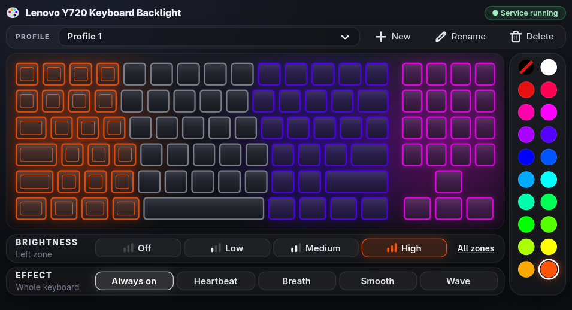

<div align="center">

  # Lenovo Y720 Keyboard Backlight

  *Set the colors of your Lenovo Legion Y720 keyboard on Linux.*

</div>

The Legion Y720 has an RGB keyboard, but Lenovo only made software for it on Windows. This app does the same job on Linux. You can pick a color for each part of the keyboard and an effect for the whole thing, save them as profiles, and switch between profiles with a key.

Your colors are restored when the laptop starts, before you log in.

<p align="center">
  
</p>

## What you can do

- **Color each zone on its own, or the whole keyboard at once.** The keyboard has four zones: three across the main keys, left to right, and one for the numpad. Set it to **Full** for one color across the whole keyboard.
- **Pick an effect.** Always on, Breath, Heartbeat, Smooth, or Wave.
- **Choose from 20 colors** and four brightness levels: Off, Low, Medium, and High.
- **Save profiles** and flip through them with **Fn+Space**.
- **Turn the lights off** with the built-in **Off** profile. It's always at the top of the list, so Fn+Space passes through it too.
- **Open the settings window** with **Fn+numpad 7**, or from the tray icon or your app launcher.

> [!NOTE]
> Fn+numpad 7 only works while Num Lock is off. With Num Lock on, the key just types a 7.

## Install

Download the package for your system from the [latest release](https://github.com/impero365/lenovo-Y720-keyboard-backlight/releases/latest). Each release has an Arch package (`.pkg.tar.zst`), an Ubuntu package (`.deb`), and a `SHA256SUMS` file to check them against.

### Arch Linux

```bash
curl -LO https://github.com/impero365/lenovo-Y720-keyboard-backlight/releases/latest/download/y720-kbled-x86_64.pkg.tar.zst
sudo pacman -U y720-kbled-x86_64.pkg.tar.zst
```

That's it. The lights come on with your saved colors from now on, every time the laptop boots.

To upgrade, run the same two commands again: the link always points to the newest release, and the package installs over the old one. You don't need to uninstall first. In fact, don't: uninstalling deletes your saved profiles.

### Ubuntu 24.04

```bash
curl -LO https://github.com/impero365/lenovo-Y720-keyboard-backlight/releases/latest/download/y720-kbled_amd64.deb
sudo apt install ./y720-kbled_amd64.deb
```

To upgrade, run the same two commands again.

### Check the download

Optionally, download `SHA256SUMS` from the same release into the same folder and run:

```bash
sha256sum --check --ignore-missing SHA256SUMS
```

### Uninstall

On Arch:

```bash
sudo pacman -Rns y720-kbled
```

This removes the app and also **deletes your saved profiles**.

On Ubuntu, `sudo apt remove y720-kbled` keeps your profiles, and `sudo apt purge y720-kbled` deletes them too.

## Using it

Most of the time you'll use the window. Open it with Fn+numpad 7, from the app launcher (look for "Lenovo Y720 Keyboard Backlight"), or from a terminal:

```bash
y720-kbled --ui
```

Closing the window doesn't turn anything off. Your colors stay as they are.

Everyone who uses the laptop shares the same profiles. Anyone logged in can change the colors.

### In the window

The window shows your keyboard with its current colors. Every change goes to the keyboard right away, and both change at the same moment.

- **Full | Split**, at the end of the Brightness row, picks how the profile lights the keyboard. Split colors the four zones one by one; Full uses one color for the whole keyboard. Click either side to switch. Each profile keeps both sets of color, brightness, and effect, and remembers which one is in use. Fn+Space lights each profile the way it was left.
- **Pick a zone** by clicking any key in it, or press **Tab** for the next zone and **Shift+Tab** for the previous one.
- **Pick a color** by clicking a circle, or use the **arrow keys**. The black circle with a red line turns that zone off.
- **Brightness** applies to the zone you picked, or to the whole keyboard in Full. **All zones** copies it to the other three zones.
- **Effect** applies to the whole keyboard.
- **New** makes a blank profile: no color, Medium brightness, Always on, in Full. **Rename** renames the profile, and **Delete** removes it.

In Full, clicking the keys and pressing Tab don't pick zones, because there is only one. The arrow keys still change the color.

The **Off** profile turns every zone off. While it's selected, the window shows a dark keyboard with "Backlight Off". It can't be renamed, changed, or deleted, and new profiles always go below it.

A fresh install starts with two profiles, Off and Profile 1, and Profile 1 is selected, so the keyboard lights up red. Profiles saved before this button existed keep their four zones, in Split.

The window fits in a quarter of a 1920×1080 screen when your desktop tiles windows.

### From the terminal

If you'd rather script it, `y720-kbled set` changes the current profile:

```bash
# Every zone solid, color 0, medium brightness
y720-kbled set --mode always_on --color 0 --brightness 2

# Just the numpad, with a wave effect
y720-kbled set --zone 3 --mode wave --color 4
```

- `--mode` is one of `always_on`, `breath`, `heartbeat`, `smooth`, or `wave`.
- `--color` is a number from 0 to 19.
- `--brightness` goes from 0 (off) to 5. The window uses 0, 1, 2, and 4, because the keyboard shows 2 and 3 the same, and 4 and 5 the same.
- `--zone` is 0, 1, or 2 for the main keys, left to right, and 3 for the numpad. Leave it out to change every zone.

`set` changes whichever side the profile is using. In Full, `--color`, `--brightness`, and `--mode` apply to the whole keyboard, and `--zone` is refused.

`set` refuses to change the Off profile. Pick another profile first, in the window or with Fn+Space.

Run `y720-kbled --help` to see every command.

## When something doesn't work

**The colors don't change.** Check that the background service is running:

```bash
systemctl status y720-kbled.service
```

**The window says "Not connected".** The window can't reach the background service. It keeps trying on its own and picks up again as soon as the service is back, for example after an upgrade restarts it. If it doesn't, start the service:

```bash
sudo systemctl enable --now y720-kbled.service
```

**Fn+Space or Fn+numpad 7 do nothing.** Make sure Num Lock is off for Fn+numpad 7. To see whether the laptop gets the key presses at all, run this and press the keys. Ctrl-C stops it.

```bash
sudo y720-kbled watch
```

**Is my keyboard detected?** This lists what the app found, without changing anything:

```bash
y720-kbled devices
```

## How it works

A small background service starts when the laptop boots and is the only thing that talks to the keyboard. It runs as its own system account, `y720`, which is the only account allowed to touch the keyboard's devices. The window, the tray icon, and the `set` command all ask the service to make changes.

Profiles are saved in `/var/lib/y720-kbled/config.json`.

## Building from source

You need a Rust toolchain, for example through [rustup](https://rustup.rs), and GTK 4 with its development files.

### Arch package

```bash
sudo pacman -S --needed base-devel gtk4
cargo fetch --locked
cd packaging
makepkg -si
```

`cargo fetch` downloads the crates first, because the PKGBUILD builds offline.

### Ubuntu package

```bash
sudo apt install build-essential pkg-config libgtk-4-dev
packaging/build-deb.sh
sudo apt install ./packaging/y720-kbled_1.1.2-1_amd64.deb
```

Build it on Ubuntu 24.04 itself. A package built on a newer system may not start on 24.04.

### Just the program

```bash
cargo build --release
./target/release/y720-kbled devices
```

Running it from a checkout doesn't change the colors by itself. The installed service does that.

### Release packages

Pushing a tag such as `v1.1.0` builds both packages on GitHub Actions and publishes them as a release, with the notes from [CHANGELOG.md](CHANGELOG.md). The tag must match the version in `Cargo.toml`, `packaging/PKGBUILD`, and `packaging/build-deb.sh`.

## Changes

See [CHANGELOG.md](CHANGELOG.md) for what changed in each version.

## Thanks

Many thanks to [Izurii](https://github.com/Izurii) for [Lenovo-Y720-KB-Led-Controller](https://github.com/Izurii/Lenovo-Y720-KB-Led-Controller), the original Linux controller for this keyboard. That project worked out how to talk to the Y720's backlight, and this app builds on what it showed.
